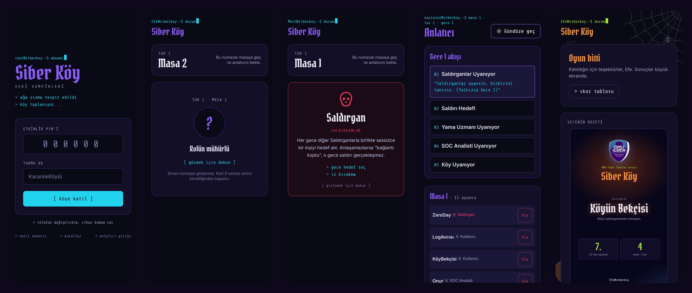
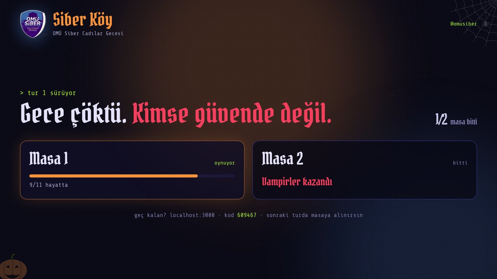
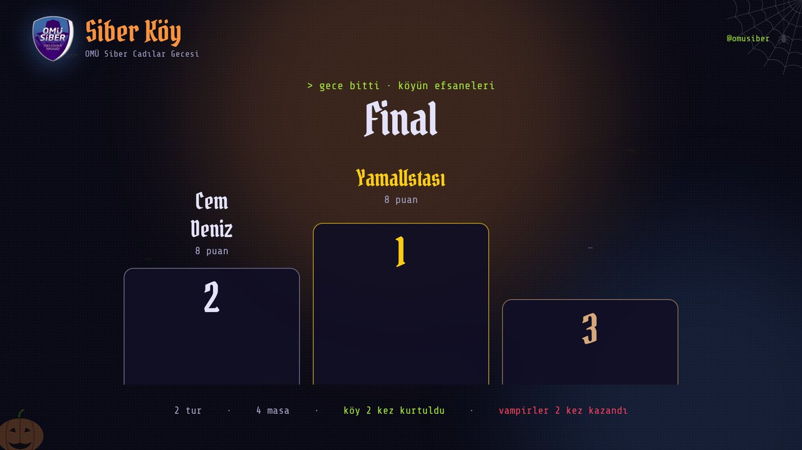
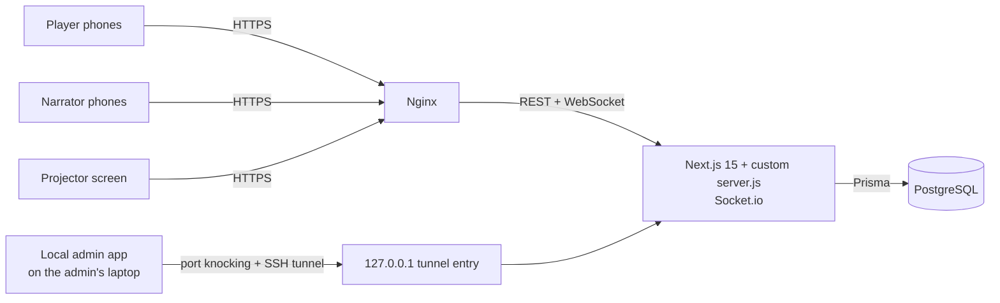
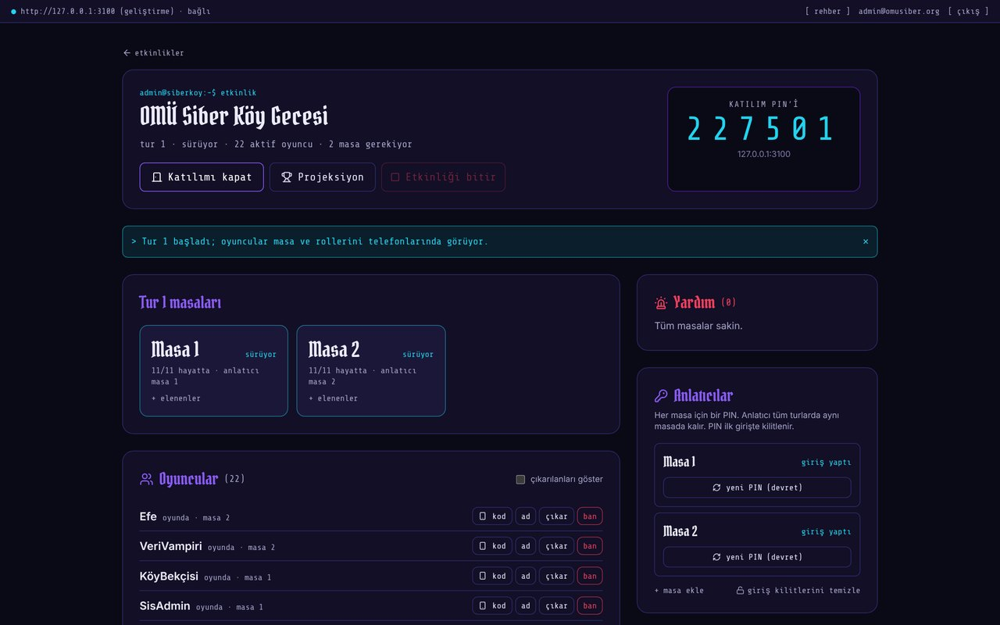

<p align="center">
  
</p>

<h1 align="center">Siber Köy: Veri Vampirleri</h1>

<p align="center">
  A live, in-person social deduction game (think <i>Werewolf / Mafia</i>) with a cyber security twist,<br>
  built for the <b>OMÜ Cyber Security Community</b> and played with nothing but phones and a projector.
</p>

<p align="center">
  
  
  
  
  
  
  
</p>

<p align="center"><a href="#english">English</a> · <a href="#türkçe">Türkçe</a></p>

---

## English

### What is it?

Siber Köy turns a classic party game into a cyber security event. Attackers ("Data Vampires") have slipped into
the village network; every night they strike in secret, every day the village debates and isolates suspects.
Roles come from real security jobs (SOC analyst, patch specialist, plain users), and every table ends with a short
mini-lesson from the narrator.

- **No app to install.** Players scan a QR code on the table, type the 6-digit event PIN and a nickname.
- **8–72 players** per event, split automatically into 1–6 tables (ideally 8–9 people each).
- **Secret roles on the phone.** The role card opens on tap and closes itself after 8 seconds.
- **Narrator panel** per table: step-by-step night script, timers, one-tap eliminations with undo, table result.
- **Live big screen**: join screen with QR, round status, live scoreboard and an animated final podium.
- **Admin console** that never touches the public internet (see [Security](#security)).

<p align="center">
  
  
</p>

### How it works



- **One process, two protocols.** `server.js` wraps Next.js and attaches Socket.io to the same HTTP server, so pages,
  REST endpoints and WebSockets share one origin, one cookie and one deploy.
- **Game logic is pure and tested.** Table allocation, role allocation, round planning (keeping last round's
  table-mates apart, best effort) and scoring live in `src/lib/` as plain functions with unit tests.
- **Randomness is cryptographic.** Shuffles use Fisher–Yates driven by `crypto` (CSPRNG), so nobody can predict
  roles or tables.

### Real-time and concurrency

Dozens of phones, several narrators and the admin act at the same time during an event, so concurrency is handled
by design rather than by luck:

- **Server-assigned rooms.** On the WebSocket handshake the server identifies the client from its HttpOnly cookie and
  puts it into private rooms (`admins`, `narrator:<pin>`, `player:<id>`, `players:<event>`). The only room a client
  can choose is the public `scoreboard:<event>` room, which never carries secrets.
- **Signals, not state.** Socket events are "refresh" signals emitted only after the database transaction commits.
  Clients then pull the current state from REST endpoints that return a role only to its owner. After a reconnect
  or when a phone wakes up, the client re-syncs, so missed events are recovered.
- **PostgreSQL does the serialising.** Starting a round, handing a table to a new narrator PIN, removing a player and
  ending the event take a per-event `pg_advisory_xact_lock`; closing a round takes a per-round lock so the last two
  tables finishing at the same moment still close the round. Eliminations and revivals take a shared row lock on
  the table, so they can never interleave with the table's result being scored.
- **Idempotent one-shot actions.** Conditional atomic updates (`UPDATE … WHERE status = 'ACTIVE'`) make double taps
  and retries harmless: a table is scored once, a player is eliminated once, a narrator PIN is claimed by one device.
  Unique constraints (nickname per event, session token hash, round and table numbers) are the last line of defence.
- **Append-only scores.** Points are only ever inserted; corrections are written as signed `ADJUSTMENT` rows, which
  keeps the scoreboard auditable.

### Security

The threat model (STRIDE) and OWASP ASVS checklist are in [`SECURITY.md`](SECURITY.md). Highlights:

- **The admin API is not on the internet.** Nginx answers `404` to every outside request for `/api/admin/*`.
  The admin runs a local panel (`admin-app/`) that knocks a port sequence, opens an SSH tunnel and talks to the app
  through `127.0.0.1` only. A time-limited, single-IP emergency mode exists for when a campus network blocks SSH.
- **Separate token types** for admins, narrators and players (JWT via `jose`), HttpOnly cookies, strict CSP.
- **Argon2id** password hashing, per-IP and per-account lockouts, and an **audit log** of every admin action.
- **Secrets never leave private rooms**: roles and eliminations are only sent to the player and their narrator.

<p align="center">
  
</p>

### Getting started

**Everything in Docker (recommended for development).** Migrations and a test admin are created automatically:

```bash
docker compose -f docker-compose.test.yml up --build
# Player site:  http://localhost:3000
# Admin panel (second terminal, development mode without a tunnel):
npm run admin -- --hedef http://127.0.0.1:3000
# Login: admin@localhost.test / yerel-test-sifresi-123
```

**Without Docker.** Set `DATABASE_URL`, `JWT_SECRET` (at least 32 characters) and
`NEXT_PUBLIC_APP_URL=http://localhost:3000` in `.env`, then:

```bash
npm install
npx prisma migrate deploy
ADMIN_EMAIL=admin@localhost.test ADMIN_INITIAL_PASSWORD='at-least-12-chars' node prisma/seed.js
npm run dev
```

**Running an event**

1. The admin creates an event in the local panel and generates one PIN per table for the narrators.
2. Players join from the QR code on the projector; narrators log in with their table PIN.
3. The admin starts a round: tables and secret roles are dealt in one click and appear on every phone.
4. Narrators run their tables and submit results; the scoreboard updates live on the big screen.
5. After the last round, the final podium plays and players can rate their narrator.

**Production.** A full step-by-step guide (TLS with Let's Encrypt, first admin account, Nginx) is in the
Turkish section below. To install next to another website on a shared VPS, follow
[`deploy/vps/KURULUM.md`](deploy/vps/KURULUM.md).

### Tests

```bash
npm test             # unit + API authorization tests (Jest)
npm run test:admin   # security rules of the local admin server
npx tsc --noEmit     # type check
npm run lint         # ESLint
```

CI runs type check, lint, tests and `npm audit` for production dependencies on every push.

### Project layout

| Path | What's inside |
|---|---|
| `src/app/` | Next.js pages (player, narrator, big screen, rules) and REST API routes |
| `src/lib/` | Game logic (allocators, planner, scoring), auth, tokens, locks, realtime helpers |
| `server.js`, `server/socket.js` | Custom server and Socket.io authentication / rooms |
| `admin-app/` | Local admin panel (Vite + React) and launcher (port knocking, SSH tunnel, local proxy) |
| `prisma/` | Schema, SQL migrations, first-admin seed |
| `nginx/`, `deploy/`, `scripts/` | Reverse proxy, VPS install guide, emergency admin access |
| `__tests__/` | Jest tests |
| `docs/` | Design decisions, closing report, screenshots, promo material |

### Docs

- [`docs/DECISIONS.md`](docs/DECISIONS.md): every design decision with its date and reason
- [`SECURITY.md`](SECURITY.md): threat model and security controls
- [`docs/ekran-goruntuleri/`](docs/ekran-goruntuleri/): full set of real screenshots (player, narrator, admin, big screen)
- [`docs/tanitim/`](docs/tanitim/): invitation, Instagram stories and the presentation for the community board

Found a security issue? Please email `admin@omusiber.org` instead of opening a public issue.

### License

[MIT](LICENSE). Use it, fork it, run it at your own club's event.

---

## Türkçe

### Nedir?

Siber Köy, herkesin bildiği "Vampir Köylü" oyununun siber güvenlik versiyonu. Köyün ağına Veri Vampirleri sızmıştır:
geceleri gizlice saldırırlar, gündüz köy tartışıp şüphelileri ağdan izole eder. Roller gerçek güvenlik işlerinden
gelir (SOC analisti, yama uzmanı, kullanıcı) ve her masa anlatıcının kısa bir mini eğitimiyle biter.

- **Uygulama indirme yok.** Oyuncu masadaki QR'ı okutur, 6 haneli etkinlik PIN'ini ve takma adını girer.
- **Tek etkinlikte 8–72 oyuncu**, otomatik olarak 1–6 masaya (ideal 8–9 kişi) bölünür.
- **Gizli rol telefonda.** Kart dokununca açılır, 8 saniye sonra kendiliğinden kapanır.
- **Masa başına anlatıcı paneli:** adım adım gece akışı, sayaçlar, tek dokunuşla eleme ve geri alma, masa sonucu.
- **Canlı büyük ekran:** QR'lı katılım ekranı, tur durumu, canlı skor tablosu ve animasyonlu final podyumu.
- **İnternete kapalı admin paneli** (aşağıda Güvenlik).

### Teknik olarak

Mimari şeması yukarıdaki İngilizce bölümde. Kısaca:

- **Tek süreç, iki protokol.** `server.js`, Next.js'i sarar ve Socket.io'yu aynı HTTP sunucusuna bağlar; sayfalar,
  REST uçları ve WebSocket aynı adresi, aynı çerezi ve aynı kurulumu paylaşır.
- **Oyun mantığı saf fonksiyon ve testli.** Masa dağıtımı, rol dağıtımı, tur planlama (önceki turun masa
  arkadaşlarını mümkün olduğunca ayırma) ve puanlama `src/lib/` altında birim testleriyle duruyor.
- **Rastgelelik kriptografik.** Karıştırmalar `crypto` (CSPRNG) ile Fisher–Yates; rol ve masalar tahmin edilemez.
- **Güvenlik:** admin API'si internete kapalı (port knocking + SSH tüneli), türe göre ayrık JWT'ler, HttpOnly
  çerezler, sıkı CSP, Argon2id, başarısız deneme kilitleri ve her admin işleminin denetim kaydı. Ayrıntılar
  [`SECURITY.md`](SECURITY.md) içinde.

#### Eş zamanlı çalışma

Bir etkinlikte onlarca telefon, birkaç anlatıcı ve admin aynı anda işlem yapar. Bu yüzden eş zamanlılık şansa
bırakılmadı:

- **Odaları sunucu belirler.** WebSocket el sıkışmasında sunucu istemciyi HttpOnly çerezinden tanır ve onu özel
  odalara koyar (`admins`, `narrator:<pin>`, `player:<id>`, `players:<etkinlik>`). İstemcinin seçebildiği tek oda,
  gizli bilgi taşımayan `scoreboard:<etkinlik>`.
- **Durum değil, sinyal.** Socket olayları, veritabanı işlemi commit olduktan sonra gönderilen "yenile" sinyalleridir.
  İstemci güncel durumu, rolü yalnızca sahibine döndüren REST uçlarından çeker. Bağlantı koptuğunda ve telefon
  uykudan uyandığında durum yeniden eşitlenir; kaçırılan olay kalmaz.
- **Sıraya sokma işini PostgreSQL yapar.** Tur başlatma, masayı yeni anlatıcı PIN'ine devretme, oyuncu çıkarma ve
  etkinliği bitirme etkinlik başına `pg_advisory_xact_lock` alır. Turu kapatma tur başına kilit alır; son iki masa
  aynı anda bitse de tur kapanır. Eleme ve diriltme masa satırına paylaşımlı kilit alır; masa sonucu girilirken
  araya giremez.
- **Tek seferlik işlemler idempotent.** Koşullu atomik güncellemeler (`UPDATE … WHERE status = 'ACTIVE'`) çift dokunuşu
  ve yeniden gönderimi zararsız kılar: masa bir kez puanlanır, oyuncu bir kez elenir, anlatıcı PIN'ini tek cihaz
  alır. Eşsizlik kısıtları (etkinlikte takma ad, oturum token özeti, tur ve masa numaraları) son güvencedir.
- **Puanlar yalnızca eklenir.** Puan kaydı silinmez; düzeltme ters işaretli `ADJUSTMENT` kaydı olarak yazılır, skor
  tablosu denetlenebilir kalır.

### Sunucuya kurulum (üretim)

> **Sunucuda başka siteler de çalışıyorsa** (ör. omusiber.org ile aynı VPS) bu bölümü değil,
> izole kurulum rehberini kullanın: [`deploy/vps/KURULUM.md`](deploy/vps/KURULUM.md). Oyun orada 80/443'ü kullanmaz,
> mevcut web sunucusunun arkasında yalnızca `127.0.0.1` üzerinde çalışır.

#### 1. Gereksinimler
- Docker ve Docker Compose (v2+)
- Bir Linux sunucu (Ubuntu 22.04+ önerilir)
- `siberkoy.omusiber.org` için yönlendirilmiş DNS A kaydı

#### 2. Projeyi klonla ve ayarları yap

```bash
git clone https://github.com/efefdev/siberkoy.git
cd siberkoy

# Ortam değişkenlerini hazırla
cp .env.example .env
```

`.env` dosyasını açıp şu değerleri değiştirin:

| Değişken | Açıklama |
|---|---|
| `POSTGRES_PASSWORD` | Güçlü bir veritabanı şifresi |
| `DATABASE_URL` | Aynı şifreyi buraya da yazın |
| `JWT_SECRET` | **Zorunlu.** `openssl rand -hex 64` ile üretin. Boş veya 32 karakterden kısaysa uygulama başlamaz |
| `NEXT_PUBLIC_APP_URL` | `https://siberkoy.omusiber.org` — CSP ve Socket.io bu adrese kilitlenir |

#### 3. İlk TLS Sertifikası (Let's Encrypt)

Nginx, sertifika dosyası olmadan başlayamaz. İlk sertifikayı Nginx'i başlatmadan, certbot'un kendi geçici sunucusuyla alın (80 portu boş olmalı):

```bash
docker compose run --rm -p 80:80 --entrypoint certbot certbot certonly \
  --standalone \
  --email admin@omusiber.org \
  --agree-tos \
  --no-eff-email \
  -d siberkoy.omusiber.org
```

Sonraki yenilemeleri `certbot` servisi 12 saatte bir dener; Nginx de 12 saatte bir yeniden yüklenerek yeni sertifikayı kullanır.

#### 4. Servisleri başlat

```bash
docker compose up -d

# Veritabanı tablolarını oluştur
docker compose exec app npx prisma migrate deploy

# İlk admin hesabı (şifre en az 12 karakter; ekrana ve shell geçmişine yazılmaz)
# Şifre komut satırına yazılmaz: `-e ADMIN_INITIAL_PASSWORD` (değersiz) değeri ortamdan alır, `ps` çıktısında görünmez.
read -rs -p "Admin şifresi: " ADMIN_PW; echo
ADMIN_INITIAL_PASSWORD="$ADMIN_PW" docker compose exec -e ADMIN_EMAIL=admin@omusiber.org -e ADMIN_INITIAL_PASSWORD app node prisma/seed.js
unset ADMIN_PW
```

#### 5. Platforma eriş

| Sayfa | URL |
|---|---|
| Ana sayfa / Oyuncu girişi | `https://siberkoy.omusiber.org` |
| Oyuncu ekranı (masa + gizli rol) | `https://siberkoy.omusiber.org/lobby` |
| Anlatıcı girişi | `https://siberkoy.omusiber.org/narrator/login` |
| Kurallar kitapçığı | `https://siberkoy.omusiber.org/kurallar` |
| Oyuncu / anlatıcı rehberi | `https://siberkoy.omusiber.org/rehber` |
| Skor tablosu | `https://siberkoy.omusiber.org/scoreboard?eventId=...` |
| Projeksiyon modu | `https://siberkoy.omusiber.org/scoreboard?eventId=...&projeksiyon=1` |

Admin paneli artık web sitesinde değil; bir sonraki bölümdeki yerel uygulamayla açılır.


### Yerel Admin Paneli

Admin API'si (`/api/admin/*`) internete **kapalıdır**: Nginx dışarıdan gelen isteklere 404 döner. Admin, panelini kendi
bilgisayarında çalıştırır; panel sunucuya **port knocking + SSH tüneli** ile bağlanır.

```
Tarayıcı ──► localhost:4400 (yerel panel) ──► SSH tüneli ──► sunucu 127.0.0.1:3000 (Nginx tünel girişi) ──► uygulama
```

#### Kurulum (bir kez, macOS)

1. Node.js 20+ kurulu olmalı (`node -v`).
2. Repo klasöründe `npm install`.
3. Ayar dosyasını oluştur ve doldur (Git'e girmez):
   ```bash
   cp admin-app/admin.config.example.json admin-app/admin.config.json
   ```
   | Alan | Açıklama |
   |---|---|
   | `publicUrl` | Sitenin adresi (acil durum modu ve projeksiyon bağlantısı için) |
   | `ssh.host` / `ssh.port` / `ssh.user` | Sunucuya SSH bilgileri |
   | `ssh.remoteAppPort` | Sunucudaki tünel girişi (docker-compose'da Nginx `127.0.0.1:3000`) |
   | `ssh.localTunnelPort` | Tünelin bu bilgisayardaki ucu (boş bir port) |
   | `knock.sequence` | Port knocking sırası: `{ "port": 7000, "protocol": "tcp" }` / `"udp"` |

#### Kullanım

```bash
npm run admin
```

1. Panel derlenir, ardından knock dizisi çalınır.
2. Terminal **SSH şifresini** sorar (şifre uygulama tarafından görülmez ve saklanmaz).
3. Tünel kurulunca tarayıcıda `http://localhost:4400` açılır; e-posta + şifre ile giriş yapılır.
4. Tünel koparsa uygulama kapıyı yeniden çalar ve tekrar bağlanır (şifre yeniden sorulur). Paneldeki üst şerit bağlantı durumunu gösterir.
5. Kapatmak için terminalde `Ctrl+C`.

#### Acil durum (tünel kurulamazsa)

Kampüs ağı SSH'yi engellerse önce telefonun mobil verisiyle dene. O da olmazsa:

1. Admin bilgisayarının dış IP'sini öğren: `curl -s https://api.ipify.org`
2. Sunucuya herhangi bir yoldan bağlan (örn. telefondan SSH) ve repo klasöründe:
   ```bash
   ./scripts/admin-acil.sh ac <IP> 120     # 120 dakika, en fazla 240
   ./scripts/admin-acil.sh durum
   ./scripts/admin-acil.sh kapat           # iş bitince erken kapat
   ```
3. Admin bilgisayarında: `npm run admin -- --acil` (tünel yerine doğrudan HTTPS; panelde sarı "ACİL DURUM" şeridi görünür).

Süre dolunca izin kendiliğinden kalkar. Nginx yeniden başlarsa da kalkar. Her açma ve kapatma `nginx/emergency/acil.log` dosyasına yazılır.

#### Etkinlik günü kontrol listesi

- [ ] Bir gün önce `npm run admin` ile bağlanıp giriş yapıldı
- [ ] Yedek admin bilgisayarında da `admin.config.json` hazır ve denendi
- [ ] Telefon hotspot'u denendi (kampüs ağı SSH'yi engellerse)
- [ ] Acil durum için sunucuya telefondan SSH erişimi denendi


### Geliştirme Ortamı

En kolayı her şeyi Docker ile çalıştırmak (migration ve test admini otomatik):

```bash
docker compose -f docker-compose.test.yml up --build
# Oyuncu sitesi: http://localhost:3000
# Admin paneli (ayrı terminalde, tünelsiz geliştirme modu):
npm run admin -- --hedef http://127.0.0.1:3000
# giriş: admin@localhost.test / yerel-test-sifresi-123
```

Docker'sız çalıştırmak için `.env` dosyasında `DATABASE_URL`, `JWT_SECRET` ve
`NEXT_PUBLIC_APP_URL=http://localhost:3000` tanımlayın, sonra:

```bash
npm install
npx prisma migrate deploy
ADMIN_EMAIL=admin@localhost.test ADMIN_INITIAL_PASSWORD='en-az-12-karakter' node prisma/seed.js
npm run dev
```

> Proje klasörünü iCloud ile senkronlanan Masaüstü/Belgeler dışında tutun (örn. `~/Projects`); `node_modules` senkronu yavaştır ve dosyalar "yalnızca bulutta" kalabilir.

#### Testleri Çalıştır

```bash
npm test            # Birim + API yetki testleri
npm run test:admin  # Yerel admin sunucusunun güvenlik kuralları
npm run admin:build # Yerel admin panelini derle
npm run test:watch  # İzleme modunda
npm run lint        # ESLint kontrolü
npx tsc --noEmit    # Tip kontrolü
```


### Proje yapısı

| Yol | İçerik |
|---|---|
| `src/app/` | Next.js sayfaları (oyuncu, anlatıcı, büyük ekran, kurallar) ve REST API uçları |
| `src/lib/` | Oyun mantığı (dağıtıcılar, planlayıcı, puanlama), oturum, token, kilitler, canlı yayın yardımcıları |
| `server.js`, `server/socket.js` | Özel sunucu, Socket.io kimlik doğrulama ve odalar |
| `admin-app/` | Yerel admin paneli (Vite + React) ve başlatıcı (port knocking, SSH tüneli, yerel proxy) |
| `prisma/` | Şema, SQL migration'ları, ilk admin hesabı |
| `nginx/`, `deploy/`, `scripts/` | Ters vekil sunucu, VPS kurulum rehberi, acil durum admin erişimi |
| `__tests__/` | Jest testleri |
| `docs/` | Tasarım kararları, kapanış raporu, ekran görüntüleri, tanıtım materyali |

### Belgeler

- [`docs/DECISIONS.md`](docs/DECISIONS.md): proje boyunca alınan tüm kararlar, tarih ve gerekçesiyle
- [`SECURITY.md`](SECURITY.md): STRIDE tehdit modeli ve OWASP ASVS kontrolleri
- [`docs/ADMIN_GUIDE.md`](docs/ADMIN_GUIDE.md): oyuncu, anlatıcı ve admin kılavuzlarının yeri
- [`docs/ekran-goruntuleri/`](docs/ekran-goruntuleri/): tüm gerçek ekran görüntüleri
- [`docs/tanitim/`](docs/tanitim/): davet, Instagram hikâyeleri ve yönetim sunumu

### Güvenlik bildirimi

Bir güvenlik açığı bulursanız lütfen herkese açık issue açmak yerine `admin@omusiber.org` adresine yazın.

### Lisans

[MIT](LICENSE). Kullanabilir, çatallayabilir, kendi topluluğunuzun etkinliğinde çalıştırabilirsiniz.
