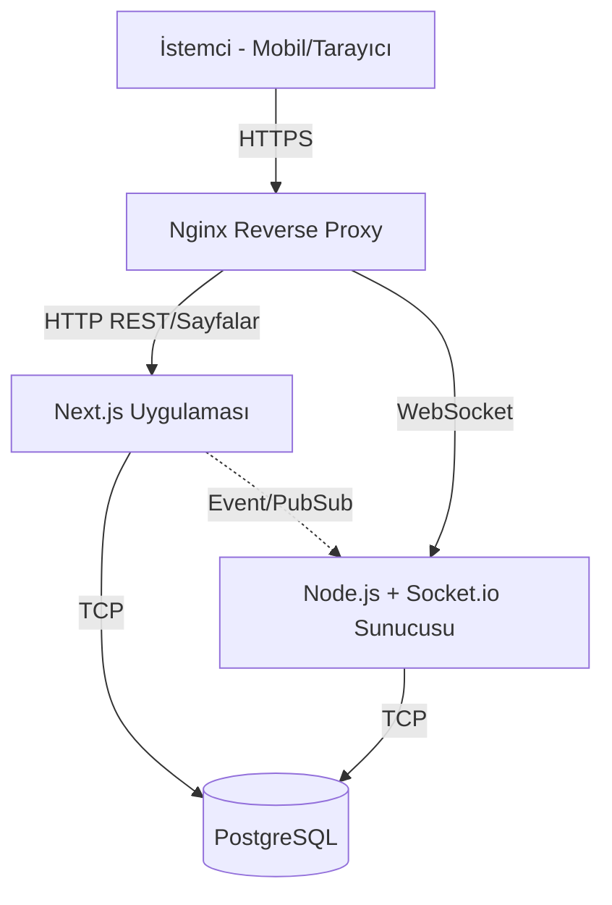

# Siber Köy Mimari Tasarımı

> İlk tasarım taslağı (Ekim 2026). Uç adları ve bazı ayrıntılar sonradan değişti; güncel yapı için
> [README](../README.md) ve [`DECISIONS.md`](DECISIONS.md).

## 1. Sistem Mimarisi

Sistem, Next.js (Full-stack) ve özel bir Node.js sunucusu (Socket.io için) birleşiminden oluşur. Veritabanı olarak PostgreSQL kullanılmaktadır. Tüm yapı Dockerize edilerek tek bir sunucuda barındırılacaktır.

## 2. Veri Modeli (Schema Özeti)

Temel veri modelleri ve ilişkileri:

- **Admin:** (id, email, password_hash, created_at)
- **Event:** (id, name, event_pin, status, created_at, closed_at)
- **NarratorPIN:** (id, event_id, pin, is_active, created_at)
- **Player:** (id, event_id, username, session_token, status, created_at, last_active)
- **Round:** (id, event_id, round_number, start_time, end_time, status)
- **Room:** (id, round_id, name/number, narrator_id)
- **RoomAssignment:** (id, room_id, player_id, role)
- **ScoreEvent:** (id, event_id, player_id, score, reason, created_by, created_at)
- **AuditLog:** (id, action, actor_id, actor_type, target_id, ip_address, created_at)

## 3. Gerçek Zamanlı İletişim Tasarımı (Socket.io)

### Olaylar (Events)
**İstemciden Sunucuya (Client to Server):**
- `player:join` -> Oyuncu token ile bağlanır, mevcut durumunu alır.
- `narrator:join` -> Anlatıcı PIN ile bağlanır, odasını yönetmeye başlar.
- `admin:join` -> Admin token ile bağlanır, tüm güncellemeleri dinler.
- `room:action` -> Anlatıcı masadaki bir oyuncunun durumunu günceller (Örn: Elendi işaretler).

**Sunucudan İstemciye (Server to Client):**
- `event:state_change` -> Etkinlik durumu değişti (Örn: Tur başladı, bitti).
- `player:assigned` -> Oyuncuya oda ve rol atandı.
- `room:updated` -> Odadaki oyuncuların güncel durumu anlatıcıya iletilir.
- `scoreboard:updated` -> Skorlar değişti, ekran güncellensin.

### Bağlantı Yönetimi
- Tarayıcı kapansa bile, `session_token` (HTTPOnly çerez veya LocalStorage üzerinden güvenli iletişim) ile Socket.io yeniden bağlanma (reconnection) işlemini otomatik yönetir.
- Ağ kopmalarında durum eşitlemesi için bağlantı kurulduğunda sunucudan en güncel "state" çekilir.

## 4. API Listesi (REST / Next.js API Routes)

### Auth
- `POST /api/auth/admin/login`
- `POST /api/auth/admin/logout`
- `POST /api/auth/narrator/login` (Geçici PIN ile)
- `POST /api/auth/player/join` (Etkinlik PIN'i ve Kullanıcı adı ile)

### Event & Round (Admin)
- `POST /api/admin/events` (Etkinlik oluştur)
- `PATCH /api/admin/events/:id` (Durum değiştir)
- `POST /api/admin/events/:id/rounds` (Yeni tur başlat, odaları dağıt, rolleri ata)
- `POST /api/admin/events/:id/narrator-pins` (Anlatıcı PIN'i üret)

### Room & Gameplay (Narrator)
- `GET /api/narrator/room` (Atanmış odayı getir)
- `POST /api/narrator/room/players/:id/eliminate` (Oyuncuyu ele, saat kaydını tut)
- `POST /api/narrator/scores` (Puan ekle)

### Public / Player
- `GET /api/event/status` (Genel durum, lobby)
- `GET /api/scoreboard` (Skor tablosu - Tur süreleriyle birlikte sıralı)
